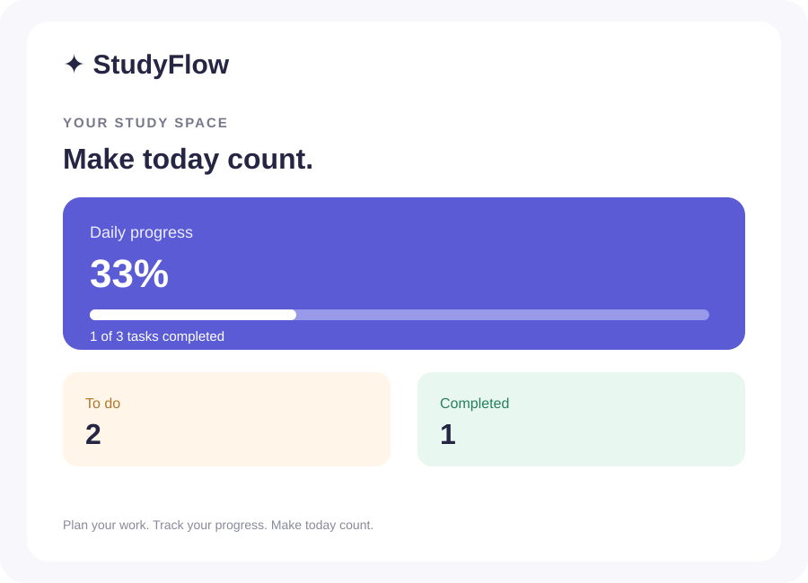
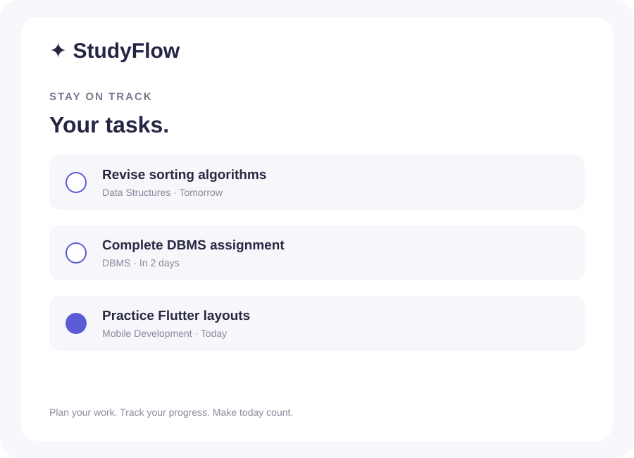
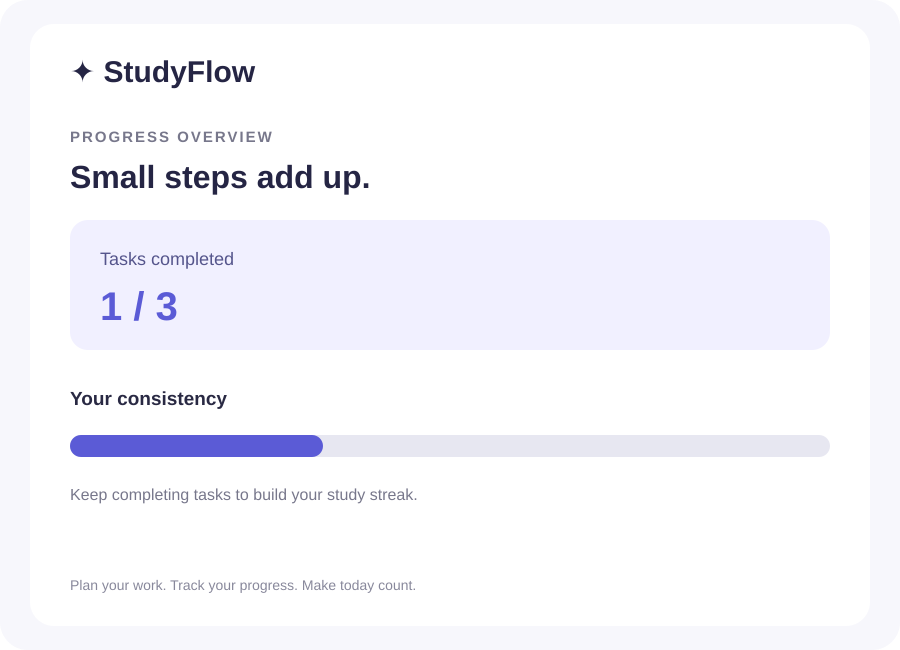

# StudyFlow 📚

A clean, beginner-friendly Flutter study planner that helps students organize assignments, track study progress, and stay consistent.

## Features

- **Dashboard** — see your daily overview and completion progress.
- **Task management** — add tasks with a title, subject, due date, and priority.
- **Progress tracking** — monitor completed and pending tasks.
- **Local storage** — tasks stay saved on your device with SharedPreferences.
- **Material 3 UI** — responsive layout with a simple, modern design.

## Getting started

### Prerequisites
- Flutter SDK (stable channel)
- Dart SDK (included with Flutter)
- Android Studio or VS Code with Flutter extensions

### Run locally

```bash
git clone https://github.com/reddykancharlakoushik-netizen/studyflow-flutter.git
cd studyflow-flutter
flutter pub get
flutter run
```

## Project structure

```
lib/
  main.dart
test/
  widget_test.dart
screenshots/
  home-dashboard.svg
  task-list.svg
  progress.svg
```

## Screenshots

The screenshots below are lightweight UI previews of the app's main screens.

| Dashboard | Task list |
|---|---|
|  |  |



## Built with

- Flutter
- Dart
- Material 3
- shared_preferences

## Testing

Run the test suite with:

```bash
flutter test
```

## Contributing

Suggestions and improvements are welcome. Fork the repository, create a feature branch, and open a pull request.

## License

This project is licensed under the MIT License. See [LICENSE](LICENSE).
